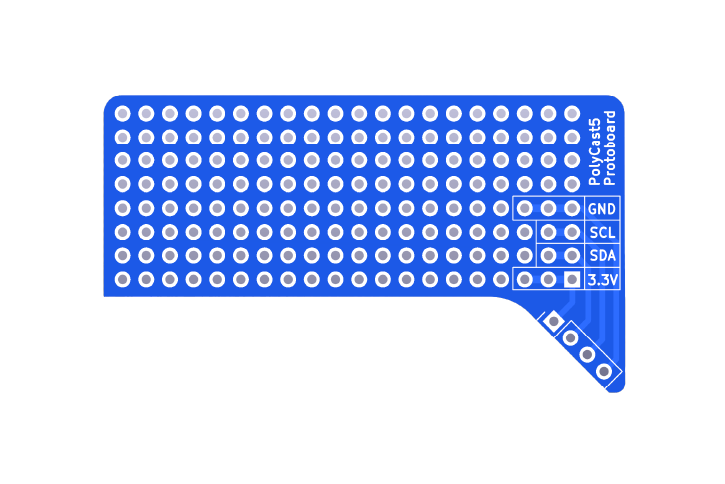

# PolyCast5 Attachment Protoboard

KiCad files for the PolyCast5 attachment protoboard! Use it to build your own add-ons for PolyCast5. It is a plain perfboard-style attachment, with power and I2C already routed to labeled pads.

See [polycast5.com/blogs/tutorials/create-external-hardware](https://polycast5.com/blogs/tutorials/create-external-hardware) for more info.

  

## Files

| File | Contents |
|------|----------|
| `PolyCast5-Protoboard.kicad_pro` | KiCad project (open this one) |
| `PolyCast5-Protoboard.kicad_sch` | Schematic |
| `PolyCast5-Protoboard.kicad_pcb` | PCB layout |
| `PolyCast5-Protoboard.kicad_prl` | KiCad local project settings |
| `PolyCast5-Protoboard-GERBER.zip` | Gerbers and drill files, ready to upload to a PCB fab |

Made with KiCad 9. Older versions can't open these files.

## Board

- 2-layer, 1.6 mm, about 62 × 36 mm
- About 150 unconnected 2.54 mm prototyping pads
- Two 4-pin 2.54 mm headers, wired in parallel:

| Pin | Signal |
|-----|--------|
| 1 | +3V3 |
| 2 | SDA |
| 3 | SCL |
| 4 | GND |

- **J1 (IN)** connects to PolyCast5.
- **J2 (OUT)** passes the same bus on, so you can chain another I2C board.
- Six extra pads break out the bus: +3V3 (×2), GND (×2), SDA and SCL.

## Ordering

Upload `PolyCast5-Protoboard-GERBER.zip` to any PCB fab (JLCPCB, PCBWay, OSH Park, ...) as a 2-layer board.

If you change the layout, export new gerbers from the PCB editor with **File → Fabrication Outputs**.
